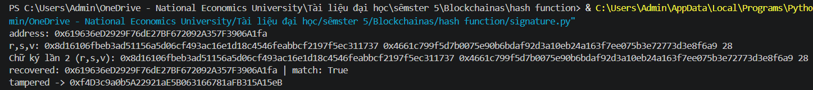

# Lab 03 — Hash, Merkle tree & Digital Signatures

## Lab 3.1 — Hash properties & toy Proof-of-Work

**Q1: Mỗi số 0 thêm vào (leading zero) làm khối lượng công việc kỳ vọng (expected work) tăng lên xấp xỉ bao nhiêu lần? Vì sao?**
Mỗi số 0 thêm vào làm tăng công việc lên ~16 lần. Vì thuật toán SHA-256 cho ra giá trị băm dạng hex (gồm 16 ký tự từ 0-9 và a-f). Giả sử các ký tự đầu ra là ngẫu nhiên và độc lập, xác suất để $k$ ký tự đầu tiên đều là "0" là $(1/16)^k$. Do đó, số lần thử kỳ vọng để tìm được mã băm thỏa mãn là $E[work] = 16^k$. Tức là cứ thêm 1 số 0 ở đầu, kỳ vọng số lần tính toán lại bị nhân lên ~16 lần. 
*(Lưu ý: Thực tế khi chạy chương trình, tỷ lệ tăng ở từng bước dao động mạnh do `nonce` là một biến ngẫu nhiên tuân theo phân phối hình học có phương sai lớn).*

**Q2: Kiểm tra nonce tìm được tốn mấy lần gọi băm? Điều đó nói gì về PoW?**
Việc kiểm tra (verify) chỉ tốn duy nhất **1 lần** gọi hàm băm `sha256(data+nonce)`, trong khi việc tìm ra nó phải mất tới $\sim 16^k$ lần thử. 
Điều này thể hiện tính bất đối xứng cốt lõi của cơ chế Proof-of-Work (PoW): Quá trình giải bài toán (tìm nonce) tốn chi phí tính toán khổng lồ và rất khó, nhưng quá trình kiểm tra lại cực kỳ dễ dàng, nhanh chóng và rẻ. Nhờ vậy, mạng lưới có thể dễ dàng xác minh các block hợp lệ, đồng thời ngăn chặn các hành vi tấn công giả mạo vì chi phí tạo ra bằng chứng giả là quá đắt đỏ.

---

## Lab 3.2 — Merkle tree

**Q3: Với n = 1,000,000 giao dịch, một proof chứa bao nhiêu giá trị băm?**
Một proof sẽ chứa **20 giá trị băm**.
Giải thích: Chiều cao của một Merkle tree chứa $n$ lá được tính bằng công thức $\lceil \log_2(n) \rceil$. Với $n = 1.000.000$, ta có $\log_2(1.000.000) \approx 19.93$. Làm tròn lên ta được 20 tầng (không tính gốc). Do đó, cần 20 node anh em (siblings) tương đương với 20 giá trị băm để đi từ lá lên tới gốc.

**Q4: Nêu một hệ thống thực dùng đúng cơ chế này (SPV, airdrop claim, proof-of-reserves…).**
Hệ thống thực tế sử dụng: **SPV (Simplified Payment Verification) trong mạng lưới Bitcoin.**
Giải thích: Các ví Bitcoin nhẹ (light nodes/ví trên điện thoại) không có đủ dung lượng tải toàn bộ blockchain. Chúng chỉ tải các Block Headers (chứa Merkle Root). Khi cần xác minh một giao dịch có thực sự tồn tại trong một block hay không, ví nhẹ sẽ yêu cầu một Full Node cung cấp Merkle Proof. Ví nhẹ sau đó dùng giao dịch (leaf) và proof để tính ngược lên. Nếu mã băm cuối cùng khớp với Merkle Root trong header, giao dịch đó được xác nhận hợp lệ mà không cần kiểm tra hàng ngàn giao dịch khác trong block.

---

## Lab 3.3 — Sign, verify & recover with eth-account

**1. Kết quả chạy Lab 3.3**

**2. Trả lời câu hỏi:**

*   **Chạy hai lần cùng thông điệp — chữ ký có giống nhau không? RFC nào giải thích điều này?**
    Nếu dùng cùng một private key để ký cùng một thông điệp 2 lần, chữ ký tạo ra sẽ **giống hệt nhau**. Tiêu chuẩn giải thích cho cơ chế này là **RFC 6979**. RFC 6979 giúp tạo ra số ngẫu nhiên (`nonce k`) cho thuật toán ECDSA một cách tất định (deterministic) dựa trên chính private key và nội dung thông điệp, loại bỏ rủi ro bảo mật từ các bộ tạo số ngẫu nhiên kém, khiến chữ ký không thay đổi qua các lần chạy.

*   **Thông điệp bị sửa khôi phục ra địa chỉ khác. Giải thích vì sao đây là bằng chứng toàn vẹn (Integrity):**
    Quá trình khôi phục địa chỉ (recover) sử dụng thông điệp đầu vào và chữ ký để tính toán ngược lại địa chỉ công khai (public address). Khi thông điệp bị thay đổi dù chỉ 1 ký tự, mã băm của thông điệp đó bị thay đổi hoàn toàn. Kết hợp mã băm sai lệch này với chữ ký ban đầu thông qua toán học đường cong elliptic sẽ trả về một địa chỉ hoàn toàn ngẫu nhiên và sai lệch. 
    Vì địa chỉ khôi phục không khớp với địa chỉ người ký ban đầu, ta có thể lập tức khẳng định dữ liệu đã bị ai đó sửa đổi trên đường truyền. Tính chất này đảm bảo bằng chứng toàn vẹn của dữ liệu (Data Integrity).

