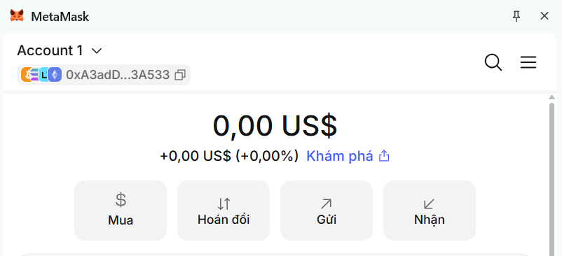
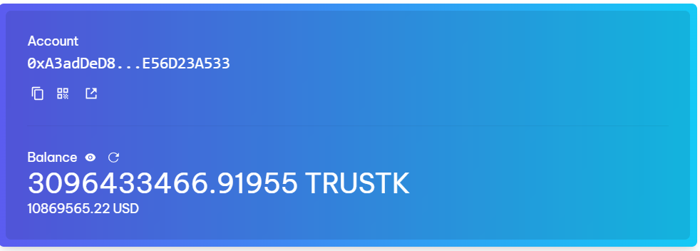
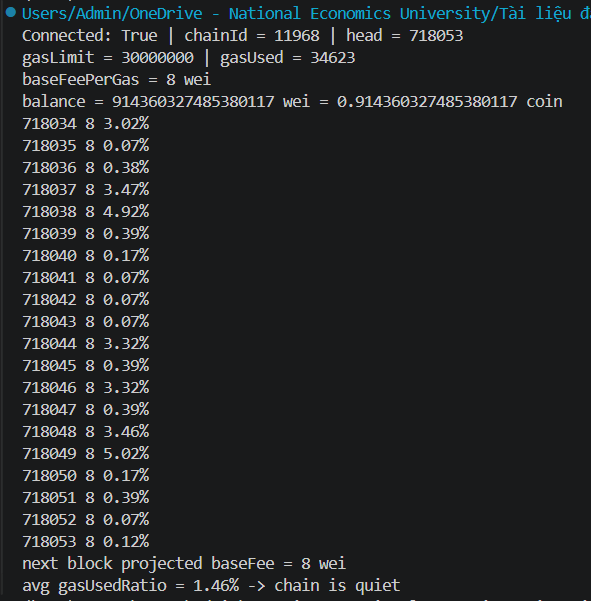
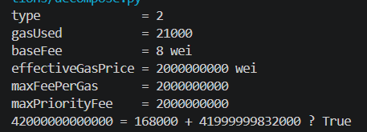
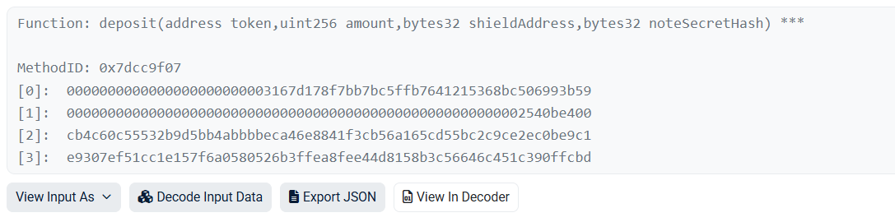
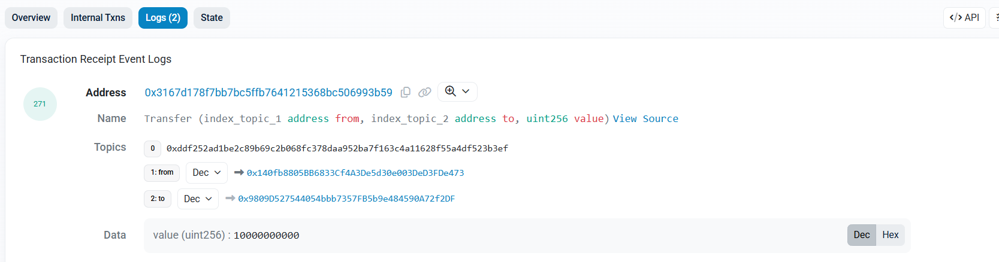

## Lab 5.1:

- Địa chỉ MetaMask trên Trustkeys L1: 0xA3adDeD89109E99BCdcA1365A2303eE56D23A533 (trùng với Demchat)
- **Answer Q1**: Trong các giao dịch, chainId được đưa vào dữ liệu được ký (EIP-155) để chống replay attack. Cùng một khóa bí mật cho cùng một địa chỉ trên mọi chuỗi EVM, nên nếu chữ ký không gắn với bất kỳ chuỗi nào, một giao dịch đã ký trên TrustKeys L1 (chainId 11968) có thể bị phát lại trên Sepolia hay mainnet. Có chainId trong chữ ký thì giao dịch chỉ hợp lệ trên đúng chuỗi đã định.

## Lab 5.2:
- Output fee_history.py:

- **Answer Q2:** EIP-1559 điều chỉnh base fee theo mức dùng gas của block trước so với mục tiêu 15M gas (50% của trần 30M). Block đầy hơn mục tiêu thì base fee tăng tối đa 12.5%, vơi hơn mục tiêu thì giảm tối đa 12.5%. Trên TrustKeys L1, trong 20 block gần nhất gasUsedRatio chỉ dao động từ 0.07% đến 5.02% (trung bình 1.46%), thấp hơn nhiều so với mục tiêu 50%, nên không có áp lực nào đẩy base fee lên. Base fee vì thế liên tục giảm cho đến khi chạm mức chỉ vài wei (8 wei). Ở mức này, công thức giảm dùng phép chia số nguyên (làm tròn xuống): 8 × (target − gasUsed) / target / 8 vẫn nhỏ hơn 1 wei khi block có dùng một ít gas, nên mức giảm làm tròn về 0 và base fee đứng yên ở 8 wei.
- **Answer Q3:** baseFeePerGas có N+1 phần tử vì phần tử cuối cùng là base fee dự kiến của block kế tiếp (block chưa tồn tại), được giao thức tính từ gasUsed và gasLimit của block mới nhất. Còn gasUsedRatio chỉ có N phần tử vì chỉ có N block đã thực sự được tạo. Ví dùng phần tử dư này để đặt maxFeePerGas: lấy base fee của block kế tiếp làm mốc, rồi đặt maxFeePerGas ≈ 2 × nextBaseFee + maxPriorityFee. Hệ số 2 là vùng đệm, vì base fee có thể tăng thêm nhiều lần 12.5% trong lúc giao dịch chờ được đưa vào block, nhờ đó giao dịch không bị kẹt. Phần trần không dùng hết sẽ được hoàn lại, nên đặt trần cao không làm bạn trả nhiều hơn.

## Lab 5.3:
- Output decompose.py:

- **Answer Q4:** Công thức là effectiveGasPrice = baseFee + min(maxPriorityFee, maxFee − baseFee). Trong giao dịch của em, baseFee = 8 wei, maxFee = maxPriorityFee = 2 gwei, nên maxFee − baseFee = 2 gwei − 8 wei, nhỏ hơn priority fee. Vì vậy min lấy maxFee − baseFee, và effectiveGasPrice = 8 + (2.000.000.000 − 8) = 2.000.000.000 wei, bằng đúng maxFee.

Nếu em chỉ nâng max base fee và giữ nguyên priority fee, thì trong trường hợp này effectiveGasPrice có đổi, nhưng rất ít. Nó tăng tối đa đến baseFee + maxPriorityFee = 2.000.000.008 wei, tức chỉ hơn 8 wei. Sau đó, nâng maxFee thêm nữa không làm giá đổi nữa, vì min đã chọn maxPriorityFee. Nói chung, khi maxFee đã đủ lớn hơn baseFee thì effectiveGasPrice không phụ thuộc maxFee: baseFee do giao thức quyết định theo từng block, tip bị chặn bởi priority fee, còn maxFee chỉ là mức trần bảo vệ, phần không dùng đến thì không bị tính.

- **Answer Q5:** 21.000 là intrinsic gas cố định (G_transaction) mà mọi giao dịch phải trả trước khi thực thi bất kỳ code nào. Nó trả cho các công việc cơ bản của một giao dịch: xác minh chữ ký, kiểm tra nonce, trừ và cộng số dư, và ghi giao dịch vào chuỗi. Chuyển coin thuần không có calldata và không chạy code hợp đồng, nên tổng gas dùng đúng 21.000. Giao dịch của em cũng vậy: gasUsed = 21000, phí trả = 21000 × 2 gwei = 42.000.000.000.000 wei.

Giao dịch thất bại (revert hoặc hết gas) vẫn tốn gas vì các node đã phải bỏ tài nguyên thật để nhận, kiểm tra và thực thi nó đến lúc lỗi. Gas cũng là cơ chế chống spam và DoS: nếu giao dịch lỗi miễn phí, kẻ tấn công có thể gửi vô số giao dịch lỗi để làm nghẽn mạng. Khi revert, trạng thái bị hoàn nguyên, nhưng gas đã dùng vẫn bị tính; chỉ phần gas chưa dùng được hoàn lại (riêng lỗi hết gas thì toàn bộ gas limit bị tiêu).

## Lab 5.4:
- Input Data đã giải mã

- Tab Logs:

- **Answer Q6:** Khi nhận calldata, dispatcher ở đầu bytecode hợp đồng lấy 4 byte đầu làm selector (ví dụ keccak256("transfer(address,uint256)")[:4] = 0xa9059cbb) và so sánh lần lượt với selector của từng hàm công khai bằng các lệnh EQ và JUMPI; khớp thì JUMP tới đoạn code của hàm đó. Phần calldata còn lại chỉ là các byte thô, mỗi tham số được đệm thành 32 byte, nên Etherscan cần ABI của hợp đồng để biết tên hàm và kiểu từng tham số thì mới giải mã ngược thành giá trị có nghĩa.

Trong giao dịch em chọn (0x8c361145...e6fe0 trên Sepolia), Method ID là 0x7dcc9f07, ứng với hàm deposit(address token, uint256 amount, bytes32 shieldAddress, bytes32 noteSecretHash). Bốn tham số được giải mã thành: token 0x3167...3B59, amount = 10000000000, cùng hai giá trị bytes32. Tab Logs có event Transfer(address,address,uint256) do token này phát ra với value = 10000000000, trùng với amount, cho thấy hàm deposit đã chuyển token vào hợp đồng.