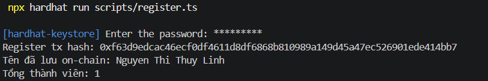
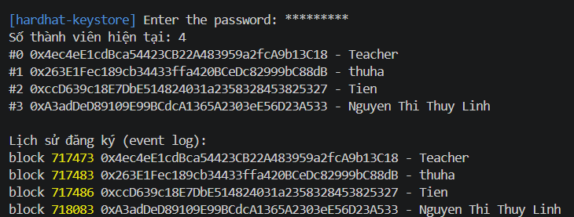

# Lab 06 – ClassRegistry với Hardhat 3 + TrustKeys
 
**Họ tên:** Nguyen Thi Thuy Linh
**MSV:** 11247188
 
---
 
## Thông tin triển khai trên TrustKeys
 
- **Mạng:** TrustKeys testnet (chainId 11968)
- **Địa chỉ contract ClassRegistry:** `0x4064F027D059658CEEb649E80276E5bbed7337C1`
- **Tx hash (deploy):** `0x5acd1675f829926ef677b344db6b130833bcc3aaad8eb926e0a09677f9e1a42c`
- **Tx hash (register):** `0xf63d9edcac46ecf0df4611d8df6868b810989a149d45a47ec526901ede414bb7`
- **Tên đã đăng ký on-chain:** Nguyen Thi Thuy Linh
Kết quả `npx hardhat test mocha`: tất cả test đều xanh (passing).
 
---
 
## Trả lời câu hỏi
 
**Q1. Test mẫu chạy ở đâu — TrustKeys hay chain cục bộ? Tốn bao nhiêu gas?**
 
Test mẫu chạy trên **chain cục bộ**: mạng mô phỏng EDR (Hardhat Network) chạy ngay trong tiến trình Node, được tạo ra khi chạy test và mất đi khi test kết thúc. Nó **không** kết nối TrustKeys vì ta không chỉ định `--network`. Gas được tính bằng ETH giả của các tài khoản có sẵn, nên không tốn tiền thật. (Gas của hàm mẫu: ___ )
 
**Q2. Vì sao `register(string calldata name)` rẻ hơn `string memory name`?**
 
Với `calldata`, chuỗi nằm sẵn trong dữ liệu đầu vào của transaction và chỉ đọc, hợp đồng đọc trực tiếp từ đó mà không phải sao chép. Với `memory`, EVM phải giải mã ABI rồi **copy** toàn bộ chuỗi vào vùng memory, tốn gas cho việc copy và mở rộng memory. Chuỗi càng dài thì chênh lệch càng lớn. Vì `register` chỉ đọc tên rồi ghi vào storage, không sửa nó, nên `calldata` là lựa chọn hợp lý.
 
**Q3. Vì sao vẫn cần `address[]` khi mapping đã lưu tên?**
 
Mapping trong Solidity không lưu danh sách key và không thể duyệt: không có `length`, không lấy được "phần tử thứ i". Mapping chỉ trả lời được "địa chỉ X có tên gì?" chứ không trả lời được "lớp có những ai?". Mảng `address[]` cho ta `memberCount()` và `memberAt(i)` để liệt kê mọi thành viên, sau đó tra tên trong mapping.
 
**Q4. Deploy là một transaction — ai trả gas, bằng coin gì?**
 
Tài khoản deployer (tài khoản ứng với `PRIVATE_KEY` trong keystore) trả gas vì tài khoản này ký và gửi transaction. Gas được trả bằng **native coin của TrustKeys testnet**, là loại coin giảng viên đã nạp vào tài khoản test (không phải ETH thật). Phí = gas đã dùng × giá gas.
 
**Q5. `queryFilter` đọc event log. Website dùng nó thế nào để hiện danh sách thành viên trực tiếp?**
 
Website dùng `ethers` kết nối RPC của TrustKeys (`JsonRpcProvider`), rồi:
1. Khi tải trang, gọi `queryFilter(filters.Registered())` (và `Deregistered` nếu có) để lấy toàn bộ lịch sử và dựng danh sách thành viên ban đầu.
2. Đăng ký lắng nghe `contract.on("Registered", (who, name) => ...)` để khi có người mới đăng ký thì thêm ngay vào danh sách; với `Deregistered` thì xoá khỏi danh sách.
3. Có thể dùng `fromBlock` để không phải quét lại từ đầu mỗi lần. Event log rẻ hơn lưu storage và có `indexed who` để lọc theo địa chỉ, nên đây là cách phổ biến để đọc lịch sử khi không có explorer.
 

